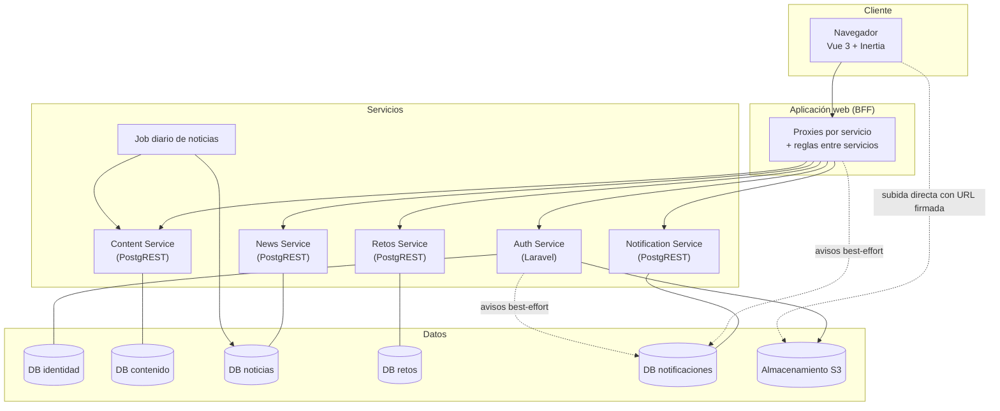
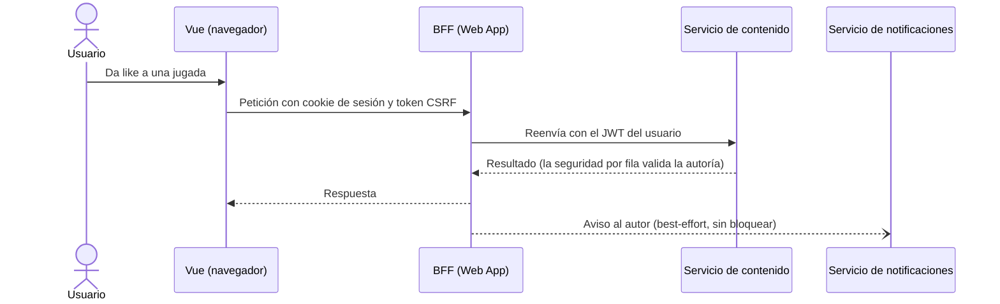
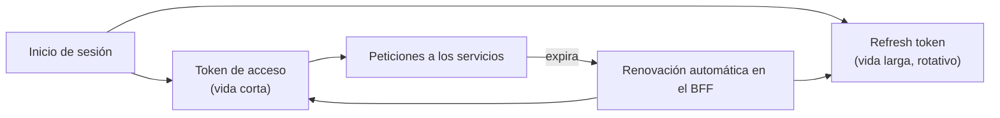

# Arquitectura

[← Volver al README](README.md)

## Principios

1. **Independencia de servicios.** Cada microservicio tiene su propia base de datos y su propio ciclo de vida. Si uno cae, los demás siguen funcionando.
2. **La seguridad vive en la base de datos.** La identidad y el rol viajan en el JWT y las políticas por fila deciden qué se puede leer o escribir.
3. **Lo simple primero.** Un servicio sin lógica propia no lleva aplicación: se expone con PostgREST. Solo se escribe código de aplicación donde hay lógica real.
4. **Las reglas entre servicios van en el BFF.** No hay consultas cruzadas entre bases de datos.
5. **Los efectos secundarios no tumban la acción principal.** Las notificaciones son *best-effort*.

## Componentes

| Componente | Responsabilidad | Tecnología |
|---|---|---|
| Web App (BFF) | Interfaz, sesión por cookies seguras, proxies hacia los servicios, reglas que cruzan servicios | Laravel + Inertia + Vue 3 |
| Auth Service | Registro, inicio de sesión, JWT, roles y permisos, solicitudes de rol, amistades, perfil | Laravel + PostgreSQL |
| Content Service | Jugadas en video, categorías, likes y comentarios | PostgreSQL + PostgREST |
| News Service | Noticias de editores, reacciones, comentarios y suscripciones | PostgreSQL + PostgREST |
| News Job | Crónica automática diaria a partir del ranking de jugadas | PHP plano + cron |
| Retos Service | Equipos, retos, resultados, puntos e insignias | PostgreSQL + PostgREST |
| Notification Service | Avisos por usuario con lectura aislada | PostgreSQL + PostgREST |
| Almacenamiento | Videos e imágenes | MinIO (compatible con S3) |

Resumen: **5 microservicios** (identidad, contenido, noticias, retos, notificaciones) y **1 aplicación web BFF**. El conteo sale de la estructura del monorepo.

## Vista general

## Flujo de una acción con notificación

Ejemplo: una persona da like a una jugada.

Puntos clave:

- El navegador nunca habla directamente con los servicios; siempre pasa por el BFF.
- El token vive en cookies seguras; el BFF lo renueva de forma transparente cuando expira.
- Si el aviso falla, el like se conserva y el error se registra.

## Sesión y autenticación

El mismo secreto de firma valida el JWT en el servicio de identidad y en cada PostgREST, de modo que cada servicio puede decidir por sí mismo sin consultar al de identidad en cada petición.

## Datos por servicio (a nivel conceptual)

| Servicio | Guarda |
|---|---|
| Identidad | Usuarios, roles y permisos, solicitudes de rol, amistades, perfiles, sesiones y registros de auditoría |
| Contenido | Categorías, jugadas, likes y comentarios |
| Noticias | Artículos (automáticos y de editores), reacciones, comentarios y suscripciones |
| Retos | Equipos, integrantes, retos, resultados, puntos, insignias e historial de puntos |
| Notificaciones | Avisos por usuario con estado de lectura y de resolución |

Las referencias entre servicios (por ejemplo, el autor de una jugada) son **lógicas**: se guarda el identificador del usuario, sin clave foránea entre bases.

## Contadores y vistas

Los contadores (likes, comentarios) se calculan en vistas de lectura en vez de mantenerse con triggers, para evitar estado duplicado que pueda desincronizarse. La excepción consciente son los puntos de los equipos, que se acumulan sobre un historial auditado.

## Tolerancia a fallos

- Cada servicio falla de forma aislada.
- La pantalla de Inicio consulta varias fuentes en paralelo; si una falla, muestra un aviso discreto y renderiza las demás. Si fallan todas, muestra un error claro con reintento.
- Las notificaciones y el job de noticias son *best-effort*: registran el error y continúan.

## Entorno

Actualmente el proyecto se ejecuta en desarrollo local, con Docker Compose para las bases de datos y los servicios expuestos con PostgREST.
