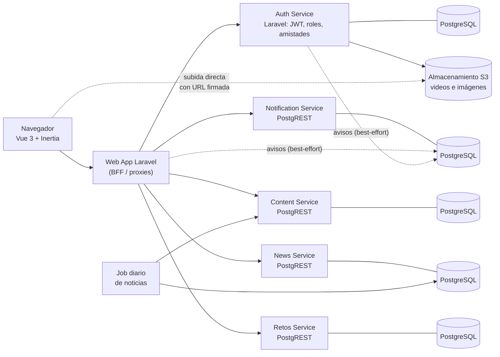
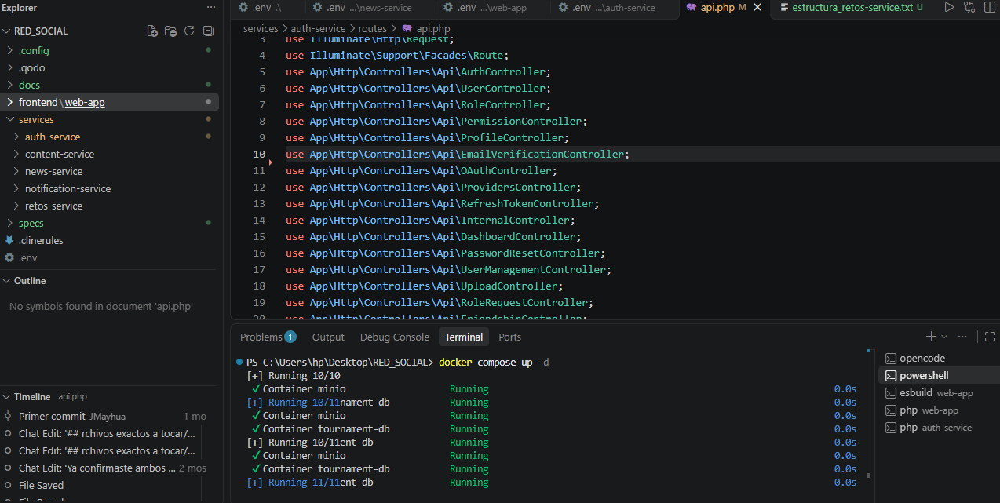
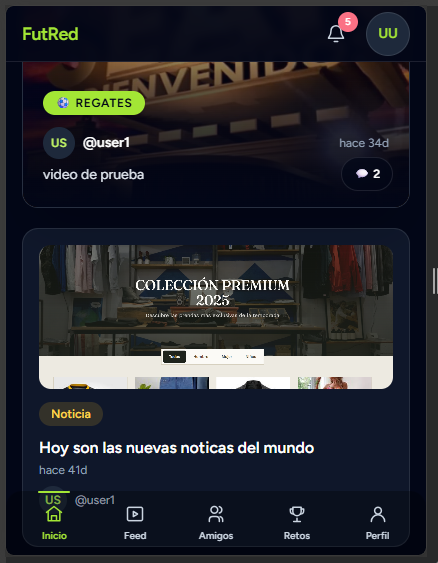
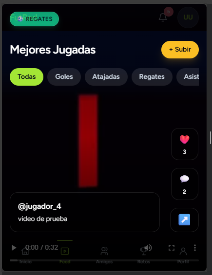
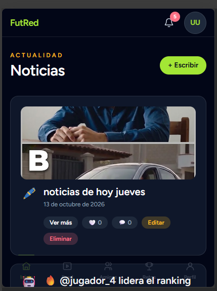
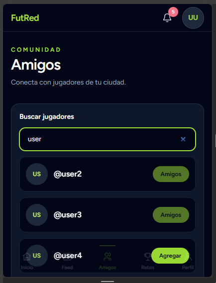
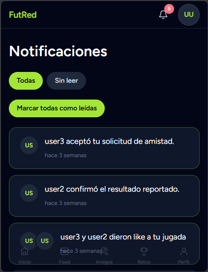
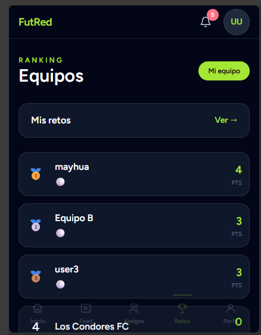
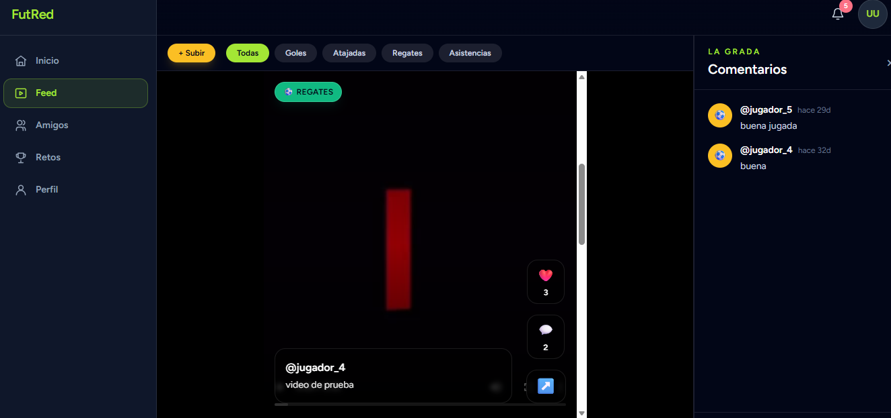

# FutRed

> Red social para fútbol amateur: jugadas en video, noticias, amigos, retos entre equipos y notificaciones, construida como un sistema de microservicios.

**Estado:** 🚧 En desarrollo · **Versión:** [v6] · **Última actualización:** [5 de noviembre del 2026]

> Este repositorio contiene **solo documentación**. El código fuente es privado. AL FINAL SE ENCUENTRAN LAS CAPTURAS DEL PROYECTO

**Documentación detallada:** [Arquitectura](ARQUITECTURA.md) · [Decisiones técnicas](DECISIONES.md) · [Seguridad](SEGURIDAD.md) · [Calidad y pruebas](PRUEBAS.md) · [Estado y roadmap](ESTADO_Y_ROADMAP.md)

---

## El problema

El fútbol amateur genera mucho contenido (goles, atajadas, regates, partidos entre equipos de barrio), pero ese contenido vive disperso en grupos de mensajería y redes generalistas. No hay un lugar pensado para que jugadores amateur muestren sus jugadas, encuentren a otros jugadores de su zona, armen equipos y se desafíen con resultados que cuenten.

**Para quién:** jugadores amateur, capitanes de equipo y personas que escriben sobre fútbol local (editores).

## La solución

FutRed reúne en una sola plataforma:

- **Jugadas en video** por categoría, con un feed de pantalla completa, likes, comentarios y ranking.
- **Noticias** publicadas por editores verificados, más una crónica automática diaria generada a partir del ranking de jugadas.
- **Amigos**: solicitudes mutuas, sugerencias por zona y búsqueda de personas.
- **Torneos entre equipos**: equipos con capitán, retos, resultados con confirmación cruzada (quien reporta no puede confirmar), puntos e insignias.
- **Notificaciones** agrupadas, con acciones directas desde la lista.

## Funcionalidades

### Disponibles (verificadas con pruebas reales)

- Registro con verificación de correo, inicio y cierre de sesión, y sesión renovable.
- Roles (administrador, moderador, editor y usuario) y solicitud del rol de editor, aprobada por un administrador.
- Jugadas: subida de video a almacenamiento S3, feed por categoría, likes sin duplicados, comentarios y ranking por categoría.
- Noticias: publicación por editores (editor de texto enriquecido, portada, categoría), likes y comentarios, y crónica automática diaria.
- Torneos a nivel de base de datos: equipos, retos, resultado con confirmación cruzada, puntos e insignias. Probado de extremo a extremo por API.
- Amistades: solicitud y aceptación entre cuentas, y regla "solo amigos al equipo" probada entre servicios.
- Notificaciones de like y comentario, aisladas por usuario y sin repetirse mientras no se lean.

### En desarrollo (implementado, pendiente de verificación completa)

- Amigos: búsqueda por nombre de usuario y avatares.
- Interfaz de Torneos (crear equipo, retar, reportar y confirmar), a la espera de pruebas manuales con dos cuentas.
- Notificaciones: agrupación, acciones desde la lista, resolución automática, contador de no leídas y avisos de amistad, torneos y noticias.
- Suscripción a editores (la base de datos está lista; la interfaz está en verificación).
- Inicio como feed social mixto (videos de comunidad y amigos, y noticias de editores).
- Rediseño de interfaz por fases: navegación unificada y componentes compartidos. Falta la verificación visual en móvil, tablet y escritorio.
- Inicio de sesión social y exportación o borrado de cuenta: presentes en el código, en revisión.

### Planificado

Foto de perfil, interfaz renovada de Retos, Amigos, Feed y Perfil, límites de integrantes por equipo y endurecimiento de calidad y seguridad. Detalle en el [roadmap](docs/ESTADO_Y_ROADMAP.md).

## Arquitectura

Monorepo de **cinco microservicios independientes** y una aplicación web que actúa como *Backend For Frontend* (BFF). Cada servicio tiene su propia base de datos. Los servicios sin lógica propia se exponen directamente con PostgREST y se protegen con seguridad por fila en la base de datos.

Más detalle, incluido el flujo de una acción con notificación, en [docs/ARQUITECTURA.md](docs/ARQUITECTURA.md).

## Stack tecnológico

| Tecnología | Para qué la uso |
|---|---|
| Laravel (PHP) | Servicio de identidad y aplicación web (BFF) |
| Vue 3 + Inertia | Interfaz de usuario |
| Tailwind CSS | Estilos y sistema de diseño (tokens, tema oscuro) |
| Tiptap | Editor de texto enriquecido para noticias |
| PostgreSQL | Base de datos propia de cada servicio |
| PostgREST | API REST generada sobre la base de datos |
| JWT | Autenticación y claims para la seguridad por fila |
| Socialite | Inicio de sesión con proveedores externos |
| MinIO (S3) | Almacenamiento de videos e imágenes |
| Docker Compose | Orquestación de bases de datos y servicios en desarrollo |
| PHP plano + cron | Job diario de noticias automáticas |
| Git + Qodo | Control de versiones y revisión de seguridad |

Versiones exactas: [v6].

## Decisiones técnicas

Resumen de cinco decisiones. El registro completo está en [docs/DECISIONES.md](docs/DECISIONES.md).

1. **La seguridad vive en la base de datos.** Elegí políticas de seguridad por fila (RLS) que leen la identidad y el rol desde el JWT, porque así la regla se aplica aunque alguien llame a la API sin pasar por la interfaz. Descarté proteger solo con middleware en la aplicación web, porque duplicaría la regla y dejaría la base expuesta.
2. **Microservicios con base de datos propia y reglas entre servicios en el BFF.** Cada servicio es dueño de sus datos y no hay consultas cruzadas entre bases. Cuando una regla involucra dos servicios (por ejemplo, "solo amigos al equipo"), se aplica en el BFF. Descarté fusionar bases de datos para poder hacer joins.
3. **Sesión deslizante con refresh rotativo.** Token de acceso de vida corta y refresh de vida larga que se rota en cada uso y se guarda hasheado. La sesión se siente permanente sin alargar la vida del token de acceso. Descarté simplemente subir la duración del token.
4. **Noticias propias en lugar de una API externa.** Dos fuentes: una crónica automática diaria y editores verificados. No dependo de la cuota ni de los términos de un tercero. El job es un script PHP plano con cron, porque su tarea es una llamada HTTP y una inserción. Descarté un framework completo para algo tan pequeño.
5. **Notificaciones solo creadas por el backend.** Los clientes únicamente leen y marcan como leídas las suyas; no existe ruta para que fabriquen avisos. Las escrituras son *best-effort*: si fallan, la acción principal no se cae. Descarté permitir inserciones desde el cliente.

## Seguridad

Enfoque de defensa en profundidad: autenticación con tokens de vida corta y refresh rotativo, control de acceso en la base de datos (RLS) más permisos por rol, validación de entradas, límites de peticiones y protección CSRF. Las credenciales se gestionan fuera del repositorio.

El proyecto está en desarrollo y tuvo una revisión interna de seguridad cuyos hallazgos se están corrigiendo. No ha tenido auditoría externa. Detalle conceptual y política de contacto en [docs/SEGURIDAD.md](docs/SEGURIDAD.md).

## Calidad y pruebas

- Pruebas automatizadas solo en el servicio de identidad (11 archivos de prueba, 2 de ellos plantillas). Existen **fallos preexistentes** que están registrados y pendientes de corrección.
- Los demás servicios se verificaron con pruebas manuales de extremo a extremo por API, sin suite automatizada.
- La compilación del frontend pasa sin errores.
- Total de pruebas y cobertura: [20].

Cómo se contó cada cifra y qué falta: [docs/PRUEBAS.md](docs/PRUEBAS.md).

## Capturas de pantalla

> Las imágenes se agregarán en `docs/images/`.

*Estructura del proyecto.*

*Inicio: feed mixto de videos y noticias, con "Tu turno" y "En tu zona" en el panel lateral.*

*Feed a pantalla completa con categorías, likes y comentarios.*

*Listado de noticias con portada, categoría y suscripción al editor.*

*Amigos con pestañas, búsqueda y avatares.*

*Lista de notificaciones agrupadas con acciones rápidas.*

*Equipo, retos y resultados pendientes de confirmación.*

*Interfaz desktop.*

## Roadmap

1. Cerrar la verificación de Amigos, Notificaciones e Inicio con sesión real.
2. Ronda de pulido: camino de un usuario nuevo, mensajes de error en español y prueba con datos realistas.
3. Rediseño de Retos, Amigos, Feed y Perfil.
4. Endurecimiento de seguridad y reparación de la suite de pruebas.
5. Foto de perfil y límites de integrantes por equipo.
6. Prueba integral de los cinco servicios.
7. Monetización, solo con una comunidad activa.

Detalle en [docs/ESTADO_Y_ROADMAP.md](docs/ESTADO_Y_ROADMAP.md).

## Sobre mí y contacto

**[Jose Adolfo Mayhua Palomino]** · Ingeniero de sistemas.

- GitHub: [https://github.com/J-Mayhua]
- Correo: [joseadolfomayhua01@gmail.com]

## Licencia

Código fuente privado. Todos los derechos reservados. Este repositorio contiene solo documentación del proyecto.
