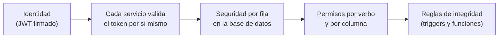

# Seguridad

[← Volver al README](../README.md)

Este documento describe el **enfoque** de seguridad del proyecto a nivel de concepto. No incluye detalles de implementación, configuración ni rutas.

## Resumen honesto del estado

- El proyecto está **en desarrollo** y no se presenta como listo para producción.
- Se hizo una **revisión interna** de seguridad del código. Sus hallazgos están en proceso de corrección y por responsabilidad no se publican.
- **No ha habido auditoría externa ni pruebas de penetración.**
- Se usa Qodo como apoyo para revisar la seguridad del código.

## Modelo de seguridad

Defensa en profundidad: ninguna capa se asume suficiente por sí sola.

## Autenticación

- Tokens de acceso de **vida corta** firmados con un secreto compartido entre el servicio de identidad y los servicios de datos.
- **Refresh token rotativo**: cada uso emite uno nuevo e invalida el anterior. En la base solo se guarda su versión hasheada.
- Cookies **HttpOnly** gestionadas por el BFF, de modo que el JavaScript del navegador no puede leer los tokens.
- Contraseñas almacenadas con hash.
- Registro con verificación de correo antes de activar la cuenta.
- Cierre de sesión que invalida los tokens, tanto en un dispositivo como en todos.

## Control de acceso

- **Seguridad por fila (RLS)** en las tablas de todos los servicios: lectura y escritura se deciden con la identidad y el rol del JWT.
- **Permisos por verbo y por columna:** además de la política, cada permiso se otorga de forma explícita. En notificaciones, por ejemplo, el cliente solo puede modificar el estado de lectura.
- **RBAC** con roles (administrador, moderador, editor y usuario) y permisos para la administración.
- **Escritura de confianza** separada: las notificaciones solo las crea el backend, con una cuenta dedicada que los clientes no pueden usar.
- **Integridad de negocio en la base:** en torneos, quien reporta un resultado no puede confirmarlo y las columnas sensibles no se editan por API.
- La interfaz oculta acciones según el rol, pero **eso es solo experiencia de usuario**: la autorización real está en la base de datos.

## Validación y protección contra ataques comunes

- **Inyección SQL:** consultas preparadas y escape de comodines en las búsquedas.
- **CSRF:** toda petición de escritura desde el navegador lleva token CSRF; no se excluyen rutas para "arreglar" errores.
- **Fuerza bruta y abuso:** límites de peticiones en inicio de sesión, registro, recuperación de contraseña, verificación y búsquedas, y bloqueo temporal por intentos fallidos.
- **Cabeceras de seguridad** en las respuestas del servicio de identidad.
- **Validación de entradas** en servidor mediante clases de validación; las asignaciones usan listas explícitas de campos.
- **Subidas de archivos:** URLs firmadas de corta duración hacia el almacenamiento; el servidor nunca recibe el video.
- **Errores:** los mensajes al usuario son claros y en español, sin texto crudo de la base de datos.

## Privacidad

- Las sugerencias de amigos usan texto de ubicación, **sin GPS ni coordenadas exactas**.
- Las respuestas de personas exponen el mínimo de campos necesario.
- Existen mecanismos de exportación y borrado de cuenta orientados a cumplir principios de protección de datos. Están en revisión y no se presentan como terminados.

## Gestión de secretos

- Los archivos de entorno **no se versionan**; el repositorio de código solo incluye ejemplos sin valores.
- Se aplicó una ronda de rotación de credenciales de desarrollo, y se rotarán de nuevo antes de cualquier despliegue.
- Ningún secreto, cadena de conexión ni dato de clientes aparece en este repositorio de documentación.

## Resiliencia

- Servicios independientes: la caída de uno no tumba a los demás.
- Los efectos secundarios (notificaciones, job de noticias) son *best-effort* y nunca bloquean la acción principal.

## Trabajo de seguridad pendiente

- Corrección de los hallazgos de la revisión interna.
- Refuerzo en la base de datos de las reglas que hoy se aplican en el BFF.
- Revisión del cifrado o hasheo de otros secretos en reposo.
- Pruebas automatizadas de seguridad y, más adelante, una revisión externa.

## Divulgación responsable

Si encuentras un problema de seguridad relacionado con este proyecto, escríbeme a [joseadolfomayhua01@gmail.com] antes de divulgarlo públicamente.
